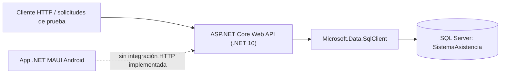

# Arquitectura del sistema

La descripción detallada de componentes, responsabilidades y flujos está en [Arquitectura y decisiones técnicas](arquitectura/README.md).

## Arquitectura implementada en el repositorio

- **Backend:** ASP.NET Core Web API en C#, con controladores de trabajadores y marcaciones.
- **Persistencia:** SQL Server con acceso mediante `Microsoft.Data.SqlClient`.
- **Móvil:** aplicación .NET MAUI dirigida a Android; actualmente captura y previsualiza fotografías.
- **Base de datos:** tablas Trabajadores, DatosFaciales y Marcaciones.

## Estado funcional

| Componente | Estado |
|---|---|
| API y conexión SQL Server | Implementadas; equipo informa compilación y pruebas locales |
| Administración de trabajadores | Implementada |
| Registro, consulta, filtro y reporte de marcaciones | Implementados |
| App MAUI Android y captura de cámara | Implementada; sin integración con backend |
| Reconocimiento facial y enrolamiento | Pendientes |
| Autenticación y autorización | Pendientes |
| Pruebas automatizadas | Pendientes |

El flujo de marcación actual usa CI como dato de prueba. No valida identidad. La tabla DatosFaciales está preparada en SQL, pero la API no implementa enrolamiento ni comparación facial.

Consultar [modelo de datos](modelo-de-datos.md), [diagramas](diagramas/README.md) y [documentación de la API](api/README.md).
