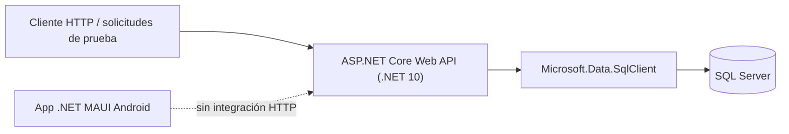

# Arquitectura y decisiones técnicas

## Componentes actuales

### Aplicación móvil

Proyecto .NET MAUI con destino `net10.0-android`. La pantalla principal solicita permiso de cámara, permite capturar una fotografía y muestra una previsualización. Todavía no envía solicitudes HTTP al backend ni realiza reconocimiento facial.

### Backend

API ASP.NET Core Web API en C# sobre .NET 10. Incluye controladores para trabajadores y marcaciones. La lógica de acceso a datos utiliza `Microsoft.Data.SqlClient` y la cadena `ConnectionStrings:ConexionSQL`.

Operaciones implementadas: registro, listado, búsqueda, modificación y desactivación de trabajadores; registro de entradas/salidas por CI; consulta general, historial, filtro por fecha y reporte de conteos por periodo.

### Base de datos

SQL Server con base `SistemaAsistencia` y tablas `Trabajadores`, `DatosFaciales` y `Marcaciones`. El script está en `src/database/01_crear_base_datos.sql`.

La tabla `DatosFaciales` existe como preparación, pero no hay implementación de enrolamiento o comparación facial.

## Diagrama del sistema actual

## Flujo de marcación actual

1. Cliente de prueba envía CI y tipo ENTRADA/SALIDA.
2. API comprueba que el trabajador exista y esté activo.
3. API valida la alternancia diaria.
4. API inserta la marcación con fecha y hora de SQL Server.
5. API devuelve el resultado.

Este flujo no verifica la identidad del trabajador mediante cámara ni biometría.

## Flujo futuro propuesto

El teléfono Android capturará la información necesaria para identificar al trabajador mediante una tecnología facial que aún debe seleccionarse. Si la identidad se confirma, enviará una solicitud autenticada a la API para registrar la marcación. El flujo, el formato de datos y la ubicación del procesamiento facial están pendientes de diseño.

## Decisiones confirmadas

- Backend: C# / ASP.NET Core Web API, .NET 10.
- Aplicación móvil: .NET MAUI para Android, .NET 10.
- Base de datos: SQL Server.
- Acceso a datos: Microsoft.Data.SqlClient.
- Terminal previsto: teléfono Android compartido.
- Identificación prevista: reconocimiento facial, aún no implementado.

## Decisiones pendientes

- Biblioteca y algoritmo facial.
- Procesamiento en el teléfono, servidor o enfoque híbrido.
- Contrato de API para la futura identificación y marcación.
- Autenticación, autorización y administración de roles.
- Almacenamiento, cifrado, retención y protección de datos biométricos.
- Política ante pérdida de conectividad.
- Reglas de horarios, tardanzas, ausencias y cálculo de horas.

## Seguridad

La API actual no implementa autenticación ni autorización. No utilizarla con datos reales hasta definir controles de acceso, transporte seguro, auditoría, protección de información personal y biométrica y pruebas de seguridad.
