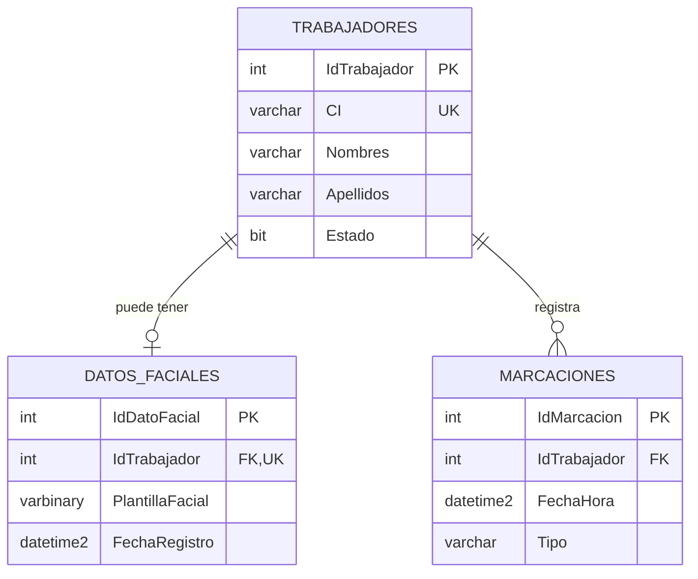

# Modelo de datos

## Motor y base de datos

- Motor: Microsoft SQL Server.
- Base: `SistemaAsistencia`.
- Script de inicialización: [01_crear_base_datos.sql](../../src/database/01_crear_base_datos.sql).
- Acceso desde API: `Microsoft.Data.SqlClient`.

El modelo corresponde al script SQL que acompaña al backend. El script crea las tablas si no existen, registra un trabajador de prueba (CI `1234567`) y una marcación de entrada inicial cuando corresponde. Está destinado a entornos de desarrollo y pruebas.

## Entidades y atributos

### Trabajadores

| Campo | Tipo SQL | Restricción / significado |
|---|---|---|
| IdTrabajador | INT IDENTITY | Clave primaria |
| CI | VARCHAR(20) | Obligatorio, único |
| Nombres | VARCHAR(100) | Obligatorio |
| Apellidos | VARCHAR(100) | Obligatorio |
| Estado | BIT | Obligatorio, por defecto 1; 1 activo y 0 desactivado |

### DatosFaciales

| Campo | Tipo SQL | Restricción / significado |
|---|---|---|
| IdDatoFacial | INT IDENTITY | Clave primaria |
| IdTrabajador | INT | Obligatorio, único y FK a Trabajadores |
| PlantillaFacial | VARBINARY(MAX) | Admite NULL; reserva para futura plantilla |
| FechaRegistro | DATETIME2 | Por defecto GETDATE() |

La tabla está creada en el esquema, pero el código actual no implementa enrolamiento, comparación o gestión de plantillas faciales. No almacenar datos biométricos reales hasta definir los controles de privacidad y seguridad.

### Marcaciones

| Campo | Tipo SQL | Restricción / significado |
|---|---|---|
| IdMarcacion | INT IDENTITY | Clave primaria |
| IdTrabajador | INT | Obligatorio, FK a Trabajadores |
| FechaHora | DATETIME2 | Obligatorio, por defecto GETDATE() |
| Tipo | VARCHAR(10) | CHECK: ENTRADA o SALIDA |

## Relaciones

## Reglas de integridad y negocio observadas

- CI es único en Trabajadores.
- DatosFaciales admite como máximo un registro por trabajador por su restricción UNIQUE en IdTrabajador.
- Cada marcación debe referenciar un trabajador existente.
- El campo Tipo solo admite ENTRADA o SALIDA.
- El backend requiere que el trabajador esté activo para registrar una marcación.
- En el mismo día, la primera marcación debe ser ENTRADA y las siguientes deben alternar entre ENTRADA y SALIDA.

## Consideraciones pendientes

- Definir esquema de versionado y migraciones de base de datos.
- Definir retención, cifrado y acceso a datos biométricos antes de activar DatosFaciales.
- Evaluar índices adicionales para consultas de historial y rangos de fechas.
- Acordar política de zona horaria para FechaHora.
- No se implementan todavía horarios laborales, tolerancias, tardanzas, ausencias ni cálculo de horas trabajadas.
