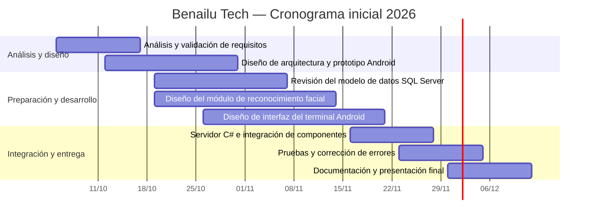

# Gantt del proyecto

## Benailu Tech — planificación inicial de octubre a diciembre de 2026

El siguiente cronograma conserva las fechas de la planificación inicial, pero actualiza las actividades para reflejar el uso de reconocimiento facial desde un teléfono Android, un servidor C# y SQL Server.

**Importante:** las fechas y responsables son tentativos. Debido al cambio de alcance, el equipo debe revisar y reprogramar las tareas. El gráfico no representa el avance real ni confirma que las actividades estén terminadas.

## Detalle

| Actividad | Inicio | Fin | Responsable |
|---|---|---|---|
| Análisis y validación de requisitos | 05/10/2026 | 16/10/2026 | Todos |
| Diseño de arquitectura y prototipo Android | 12/10/2026 | 30/10/2026 | Interfaz |
| Revisión del modelo de datos SQL Server | 19/10/2026 | 06/11/2026 | Líder / BD |
| Diseño del módulo de reconocimiento facial | 19/10/2026 | 13/11/2026 | Por confirmar |
| Diseño de interfaz del terminal Android | 26/10/2026 | 20/11/2026 | Interfaz |
| Servidor C# e integración de componentes | 16/11/2026 | 27/11/2026 | Por confirmar |
| Pruebas y corrección de errores | 23/11/2026 | 04/12/2026 | Por confirmar |
| Documentación y presentación final | 30/11/2026 | 11/12/2026 | Todos |

## Revisión necesaria

El equipo debe confirmar los responsables y actualizar las fechas de acuerdo con el avance real. También debe incorporar las tareas técnicas que se definan para la aplicación Android, el reconocimiento facial, el servidor C# y la conexión con SQL Server.
