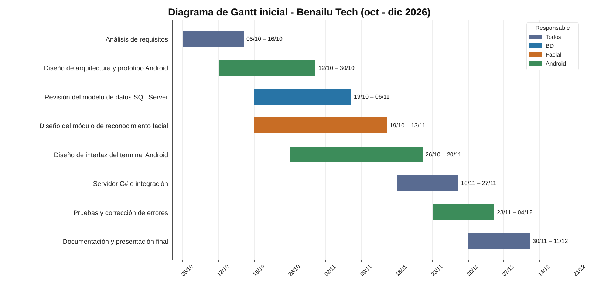

# Proyecto y planificación

## Identificación

- **Proyecto:** Benailu Tech.
- **Sistema:** control de asistencia con objetivo de identificación facial desde un teléfono Android compartido.
- **Materia:** Programación II.
- **Carrera:** Ingeniería en Sistemas.
- **Universidad:** Universidad Privada Franz Tamayo.
- **Docente:** Ing. Diego Patrick Cardenas Sejas.
- **Ubicación indicada en el documento del proyecto:** Cochabamba, Bolivia.

## Descripción y propósito

El sistema busca centralizar el registro de entrada y salida de trabajadores. La arquitectura objetivo contempla un teléfono Android en la entrada, identificación facial, un servidor C# y SQL Server.

La versión publicada incluye:
- API ASP.NET Core en C# (.NET 10) con operaciones de trabajadores y marcaciones.
- Aplicación .NET MAUI para Android (.NET 10) que solicita permiso de cámara y captura/previsualiza una fotografía.
- Script SQL Server para crear la base y tablas utilizadas por el backend.

La app no está conectada con la API. La cámara no realiza reconocimiento facial. La marcación de la API utiliza CI como dato de prueba y no verifica identidad.

## Usuarios objetivo

- Trabajadores: utilizarán el teléfono Android compartido para registrar asistencia cuando se implemente el flujo biométrico.
- Personal administrativo autorizado: administra trabajadores y consulta asistencias.
- Responsables de la empresa: revisan registros y reportes.

## Componentes y tecnologías

| Componente | Tecnología / estado |
|---|---|
| API | C# / ASP.NET Core Web API, .NET 10 |
| Acceso a datos | Microsoft.Data.SqlClient |
| Base de datos | SQL Server |
| Aplicación móvil | .NET MAUI, Android, .NET 10 |
| Reconocimiento facial | Pendiente de selección e implementación |
| Integración Android–API | Pendiente |

## Gantt

Consultar el [Gantt y fechas tentativas](GANTT.md). El equipo debe actualizar responsables y fechas con base en el avance real.

## Recursos

- Computadora para desarrollo y administración.
- Teléfono Android con cámara para el terminal previsto.
- SQL Server y herramienta de administración.
- .NET SDK 10, Visual Studio y Android SDK.

## Riesgos y aspectos por resolver

- Selección y validación de tecnología de reconocimiento facial.
- Condiciones de iluminación y calidad de captura.
- Protección de datos biométricos y personales.
- Conectividad entre teléfono y servidor.
- Autenticación y autorización.
- Reglas de horarios, tardanzas, ausencias y excepciones.
- Pruebas integrales del flujo móvil–API–SQL Server.

## Próximos pasos

1. Elegir biblioteca y método de reconocimiento facial.
2. Definir si el procesamiento se realizará en Android, servidor o ambos.
3. Diseñar el contrato de comunicación y seguridad entre app y API.
4. Implementar autenticación y autorización.
5. Integrar la app con la API.
6. Añadir pruebas automatizadas e integrales.
7. Actualizar el Gantt y la asignación nominal de responsabilidades.
